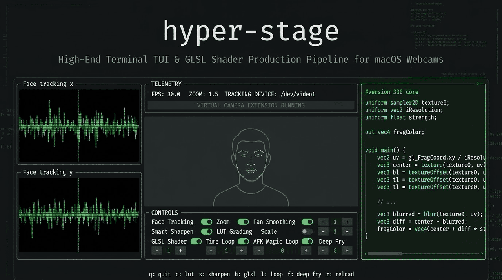
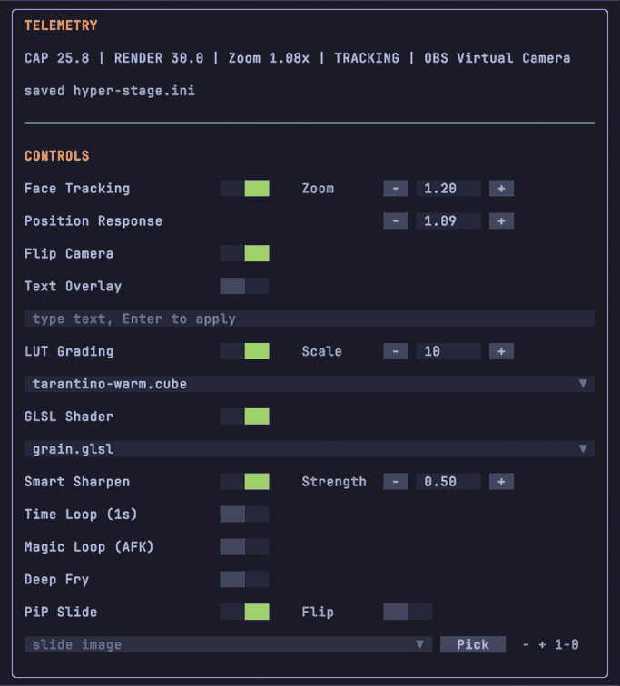
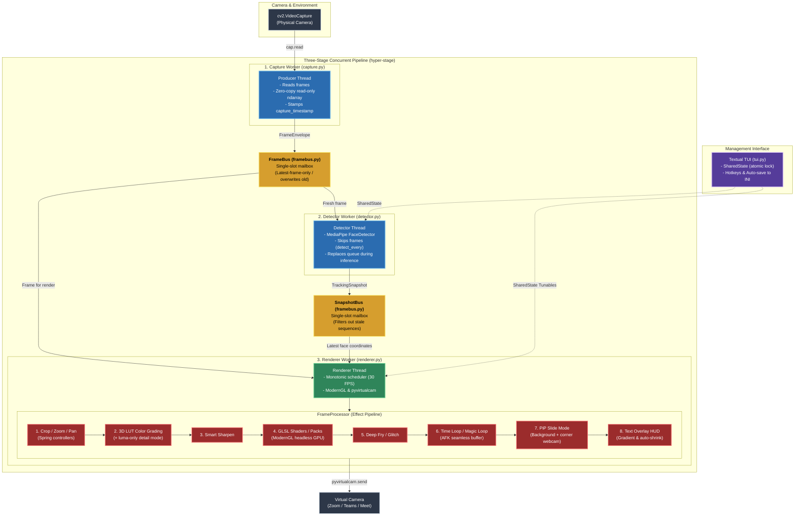

# hyper-stage 🎥✨

**Your regular webcam, but with main-character energy.**

Tired of looking like a grainy potato on 9 AM standups? `hyper-stage` hijacks your raw webcam feed, tracks your face with Apple-style Center Stage smoothness, slaps on cinema-grade 3D LUTs and real-time GPU GLSL shaders, and pipes the glow-up straight to a virtual camera at a buttery 30 FPS.

> **Peer-reviewed telemetry fact™:** Using `hyper-stage` makes video calls **4.73% less soul-crushing** (citation needed, vibes verified).

Everything runs from a slick, full-screen Textual TUI while a background daemon thread handles the heavy lifting. Toggle filters, tweak spring physics, or peace out for coffee without dropping a single frame.

---

## ⚡ Quickstart (No Cap)

Fire up the pipeline — `start.sh` installs `uv` if missing, syncs the locked dependencies, pre-downloads the face-detector model, and launches the app:

```sh
./start.sh
```

or, with `uv` already set up:

```sh
uv run main.py
```

Hit `q` (or `Ctrl+C`) to bounce — your settings auto-save before the lights go out. The virtual camera spins up the millisecond your webcam and virtual-cam backend handshake.

---

## 🎮 Controls & Keybinds

Click literally anything in the TUI (switches, dropdowns, `-`/`+` buttons, footer hints), or speedrun your call aesthetics with keyboard shortcuts (yes, even if you forgot to switch off your ЙЦУКЕН layout):

| Key       | Ru Layout | Vibe Check / Action                                                                            |
| :-------- | :-------- | :--------------------------------------------------------------------------------------------- |
| `q`       | `й`       | **Rage-quit gracefully** (saves your config first)                                             |
| `t`       | `е`       | Toggle **Face Tracking** (let the camera stalk you)                                            |
| `c`       | `с`       | Toggle **LUT Color Grading** (instant indie-film mood)                                         |
| `h`       | `р`       | Toggle **GLSL Shaders** (GPU goes brrr)                                                        |
| `s`       | `ы`       | Toggle **Smart Sharpen** (crisp edges, zero skin texture crime)                                |
| `l`       | `д`       | Toggle **1s Time Loop** (freeze time for comedic effect)                                       |
| `m`       | `ь`       | Toggle **Magic Loop (AFK)** (ultimate stealth mode, see below)                                 |
| `f`       | `а`       | Toggle **Deep Fry / Glitch** (when the meeting could've been an email)                         |
| `p`       | `з`       | Toggle **PiP Slide Mode** (meme background, tiny webcam, see below)                            |
| `i`       | `ш`       | Focus on **Text Input** (drop the text, then hit the Enter, see below)                         |
| `r`       | `к`       | Hot-reload `LUT/` and `shaders/` folders on the fly                                            |
| `]` / `[` | `ъ` / `х` | Cycle next / previous `.cube` LUT (also on-screen `]` / `[` buttons)                            |
| `>` / `<` | `ю` / `б` | Cycle next / previous `.glsl` shader (also on-screen `>` / `<` buttons)                         |
| `←↑↓→`    | —         | Move the PiP window: up/down pick top/bottom, left/right pick the side                         |
| `-` / `+` | —         | Previous / next PiP image within its folder, stops at the ends (`1`–`0` jump to its first ten) |

Everything below is also reachable from a MIDI controller — see [MIDI Controllers](#-midi-controllers).

---

## 🛠️ Dashboard Anatomy



The TUI keeps things clean in a centered 74-column layout:

- **TELEMETRY:** Live FPS, current zoom multiplier, `TRACKING` / `IDLE` status, active virtual camera device, and status notifications.
- **CONTROLS:**
  - _Face Tracking_ switch + `Zoom` tuner
  - _Flip Camera_ switch (mirror the whole feed, selfie-style)
  - _Text Overlay_ switch + text field (`i` / `ш` to focus, Enter to publish) with `[text]` ini settings (font, scale, thickness, edge padding, gradient colors)
  - _Position Response_ tuner (pan spring time; zoom is deliberately slower)
  - _LUT Grading_ + `Scale` tuner + `.cube` selector with `[` / `]` step buttons
  - _GLSL Shader_ + `.glsl` selector with `<` / `>` step buttons
  - _Smart Sharpen_ + `Strength` tuner (edge-gated so you don't look deep-fried unless you want to)
  - _Time Loop (1s)_, _Magic Loop (AFK)_, and _Deep Fry_ switches
  - _PiP Slide_ + image selector + `Pick` button (native file dialog), and _PiP Flip_ mirror toggle

---

## 🕵️ Magic Loop (Elite AFK Tech)

Need to grab an iced oat latte or pet your cat mid-sync without anyone noticing? Smash **`m`** to engage **Magic Loop**:

1. **Instant Freeze:** Face tracking locks immediately so the crop doesn't awkwardly drift while you stand up.
2. **Anti-Sus Guard:** The pipeline ignores the last ~0.8 seconds right before you pressed the key (so nobody sees your hand reaching for the keyboard or your head turning away).
3. **Vibe-Checked Seamless Loop:** It scans your rolling 10-second compressed history for the chillest 2–5 second window with the lowest motion and cleanest seam, dissolves into it over 0.4s, and loops it seamlessly until you return.
4. **Clean Re-entry:** Tap `m` again when you're back in your chair—it smoothly crossfades back to live reality and wipes the old buffer. Zero evidence.

---

## 🖼️ PiP Slide / Meme Mode

Presenting? Turn on **PiP Slide Mode** with `p` (or `з`):

1. **Background:** Pick a slide or meme via the **Pick** button (native macOS file dialog) or the dropdown. Drop `.gif/.jpg/.jpeg/.png` files into the app directory and they appear in the dropdown automatically (or hit `r` to rescan instantly). the clickable `-`/`+` buttons next to the dropdown (or the `-`/`+` keys) step through the images of the current folder (name-sorted, stops at the ends) and `1`–`0` jumps to its first ten; dropdown entries show each file's folder.
2. **Tiny You:** The live webcam shrinks to 25% of the frame and parks an equal `padding` (pixels) from the screen edges — arrows move it one axis at a time (`↑`/`↓` pick top/bottom, `←`/`→` pick left/right, the other axis stays put). Toggling PiP zooms the webcam smoothly to/from the corner over 3 seconds instead of cutting. Seeing your slide mirrored in the call? Flip on **PiP Flip** right below the toggle.
3. **Grade the feed, not the slide:** LUTs, shaders and sharpening keep applying to your camera feed only; the background image stays pristine.

Scale, edge padding (pixels), zoom animation duration and default corner live in the `[pip]` section of `hyper-stage.ini` (`animation` is seconds; `0` snaps instantly).

---

## 🎨 Shaders & LUTs (GPU Drip)

- **3D LUTs (`.cube`):** Drop your `.cube` files into `LUT/`. Selecting one bakes a $128^3$ lookup table in a background worker so your stream never stutters. Luma-only detail preservation keeps your face sharp without leaking original colors into B&W grades.
- **GLSL Shaders (`.glsl`):** Drop Shadertoy-style fragment shaders (`void mainImage(out vec4 fragColor, in vec2 fragCoord)`) into `shaders/` — the repo ships a starter pack (1-bit dither, CRT, halftone, pixel-art, optical-flow and friends). Runs headless via `moderngl` on your GPU.
  - Supports **multibuffer Shadertoy packs**! Drop a folder named `<effect>.glsl/` containing `Common.glsl`, `Buffer A.glsl`, ..., `Image.glsl` with `RGBA16F` ping-pong feedback, mipmaps, and custom channel routing directives (`// hyper-stage: 2=Buffer B`).
  - Built-in stand-ins for `camera`, `noise`, `font` (16x16 ASCII glyph atlas), and `feedback`.

---

## 🔤 Text Overlay

The `[text]` section of `hyper-stage.ini` controls the centered caption: `enabled`, `text` (the published line, persisted on autosave), `font_face` (TTF name or path, e.g. `Nothing Font C`), `font_scale`, `thickness`, `padding` (minimum gap from the frame edges) and a `color_start` → `color_end` `#RRGGBB` gradient. Type in the TUI text field (`i` / `ш`) and hit Enter to publish it — this also switches the overlay on if it was disabled. Long text automatically shrinks to fit the safe zone.

---

## 🎯 Tracking & Zoom Tuning

`[tracking]` in `hyper-stage.ini` has two independent controllers. Pan uses
`position_response_time` (seconds, default `0.7`), `position_damping` (`1.0`,
no overshoot) and `position_deadband` (`0.01` of the frame) — small head
movements never re-arm it. Zoom filters the face size from the detector's eye
landmarks (`face_size`, falling back to bbox height when landmarks are absent)
and uses `zoom_measurement_smoothing`, `zoom_deadzone`, separate
`zoom_in_response_time` (`4.0s`, slow) and `zoom_out_response_time` (`1.0s`,
responsive), `detection_timeout` (`0.5s`) and `max_measurement_change`
(`0.6`/s). Set `debug = true` to publish raw/filtered center and size,
desired/actual zoom, detection age and confidence in the telemetry panel.

---

## 🎛️ MIDI Controllers

Any class-compliant MIDI controller can drive the whole control panel: switches,
knobs, relative encoders, buttons, effect selection and PiP placement. MIDI is
optional: **the app starts exactly as before with no devices connected** and is
disabled by default.

### Supported messages

| Message             | Detail                                                                                                    |
| ------------------- | --------------------------------------------------------------------------------------------------------- |
| Control Change (CC) | Absolute values 0–127, toggles (edge-triggered), momentary buttons, relative encoders, one-shot triggers. |
| Note On / Note Off  | Note On with velocity `0` is treated as Note Off; repeated Note Ons never re-trigger a toggle while held. |

Per-mapping MIDI channels (1–16) are supported, plus a global channel filter in
`[midi]` (`channel = 0` listens to all channels). one input may drive several
targets (macro), and one target may have several inputs.

### Finding and selecting devices

```sh
uv run main.py --list-midi
```

This prints available input and output ports without starting the camera. Put
the exact names into `hyper-stage.ini`:

```ini
[midi]
enabled = true
input_device = nanoKONTROL2 MIDI 1
output_device = nanoKONTROL2 MIDI 1
channel = 1
feedback = true
auto_reconnect = true
feedback_interval = 20
button_debounce = 80
```

An empty `input_device` / `output_device` auto-selects the first available port.
If you name a device that is missing, the app **will not** silently control a
different one — it reports "input device not found" in the telemetry notice and
keeps working. `--midi` / `--no-midi` override the INI at launch.

### Mapping syntax

Every other key in `[midi]` is a target with a plain INI mapping value (never a
JSON blob). A target may hold several specs separated by `|`:

```text
type:channel:number:mode[:option...][|type:channel:number:mode...]
```

- `type` — `cc` or `note`.
- `channel` — `1`–`16`, or `0` to inherit the global channel.
- `number` — CC number or note number (`0`–`127`).
- `mode` — see below.
- `option` — `invert` (reverse direction/state) and/or `accel` (double encoder step).

| Mode              | Meaning                                                                                                      |
| ----------------- | ------------------------------------------------------------------------------------------------------------ |
| `absolute`        | CC 0–127 → the target's real range (clamped and rounded by the existing tuning logic).                       |
| `toggle`          | Edge-triggered boolean flip — one press = one change.                                                        |
| `momentary`       | Hold = on, release = off (works with note on/off and CC ≥ 64).                                               |
| `trigger`         | One-shot action (next/previous, reload, PiP corner, …).                                                      |
| `next` / `prev`   | Direction-aware one-shot cycling.                                                                            |
| `relative_twos`   | Two's complement encoder: 1–63 = +n, 64 = 0, 65–127 = −(128−n).                                              |
| `relative_binary` | Binary offset encoder: 1–63 = +n, 64 = 0, 65–127 = −(n−64).                                                  |
| `relative_0_127`  | **0 = clockwise/+1, 127 = counter-clockwise/−1**; all other values are ignored (never an absolute position). |

`relative_0_127` is the native convention of controllers that report only
direction. Default is one logical step per event; `accel` doubles it and
`invert` swaps the direction. Every relative mode ignores zero movement.

Example with faders, a relative encoder bank and buttons:

```ini
# Absolute faders -> continuous parameters.
# A direction-only encoder can drive the SAME target: separate specs with |
zoom = cc:1:10:absolute|cc:1:14:relative_0_127
position_response_time = cc:1:11:absolute
sharpen_strength = cc:1:12:absolute
lut_scale = cc:1:13:absolute

# Toggle buttons for every switch
tracking_enabled = cc:1:20:toggle
cam_flip = cc:1:21:toggle
text_enabled = cc:1:22:toggle
lut_enabled = cc:1:23:toggle
shader_enabled = cc:1:24:toggle
sharpen_enabled = cc:1:25:toggle
time_loop_enabled = cc:1:26:toggle
magic_loop_enabled = cc:1:27:toggle
deep_fry_enabled = cc:1:28:toggle
pip_enabled = cc:1:29:toggle
pip_flip = cc:1:30:toggle

# One-shot actions: effect selection, PiP cycling, corners, reload
lut_next = note:1:60:trigger
lut_prev = note:1:61:trigger
shader_next = note:1:62:trigger
shader_prev = note:1:63:trigger
pip_next = note:1:64:trigger
pip_prev = note:1:65:trigger
pip_corner_tl = note:1:67:trigger
pip_corner_tr = note:1:68:trigger
pip_corner_bl = note:1:69:trigger
pip_corner_br = note:1:70:trigger
reload_files = note:1:66:trigger
```

Separate several mappings for one target with `|` — for example a fader and a
relative encoder both controlling `zoom`. Conversely, the same CC or note can be
mapped to several different target keys to act as a macro.

### Complete target inventory

- **Switches:** `tracking_enabled`, `cam_flip`, `text_enabled`, `lut_enabled`,
  `shader_enabled`, `sharpen_enabled`, `time_loop_enabled`,
  `magic_loop_enabled`, `deep_fry_enabled`, `pip_enabled`, `pip_flip`.
- **Tuners:** `zoom` (1–4), `position_response_time` (0.2–3),
  `sharpen_strength` (0–1), `lut_scale` (2–16).
- **Selection/actions:** `lut_next`, `lut_prev`, `shader_next`, `shader_prev`,
  `pip_next`, `pip_prev`, `pip_index` (absolute CC picks an image),
  `pip_corner_tl`, `pip_corner_tr`, `pip_corner_bl`, `pip_corner_br`,
  `reload_files`, `pip_pick` (optional momentary - reuses the native picker).
- `shutdown` can be mapped explicitly (`note:1:127:trigger`) but is never a
  default and requires a **second press within 3 s** to confirm.

Magic Loop keeps its existing dependency: MIDI cannot turn tracking back on
while Magic Loop is active, and the previous tracking state is restored when it
turns off. Text stays a TUI input (arbitrary text cannot be expressed by a CC).

### MIDI Learn

Learn is context-aware: the target is **the last control you actually touched**,
not a fixed default.

1. Touch the control you want to bind: a switch, a tuner's `-`/`+` button or
   Input (Enter), a dropdown, the LUT `[`/`]` or shader `<`/`>` steppers, or the
   PiP `-`/`+` image steppers. Keyboard focus alone is not enough.
2. Press `Ctrl+M` — the notice shows `MIDI LEARN → Zoom` (or the control you
   touched). If you have not touched a mappable control yet, the app asks you to
   select one instead of guessing a target.
3. Move a knob or press a button on the controller. The notice updates to
   `MIDI LEARN → Zoom → CC 10 CH 1` and the mapping is saved straight into
   `[midi]`.
4. If that target already has a mapping, capture once more to confirm the
   replacement — an existing mapping is never overwritten by accident.
5. `Ctrl+M` again (or a 15 s timeout) cancels. `Ctrl+N` / `Ctrl+B` still let you
   browse targets manually. Learn messages are consumed exclusively, so the
   captured control never also fires its old action.

Programmatic UI updates, panel refreshes, MIDI-originated changes and feedback
never change the remembered target; neither do non-mappable controls such as the
free-text overlay field.

### Bidirectional feedback

With `feedback = true`, state changes from **either** interface send CC `0`/`127`
(or Note On/Off for note mappings) to the mapped controller output, and tuners
send their position scaled to 0–127. LUT/shader/PiP changes and reloads send a
short pulse. Output is throttled by `feedback_interval`, de-duplicated so only
real changes emit, and guarded against software loopback. With `feedback =
false` (or no output port) input control works identically.

**LED rings, motorized faders and button LEDs depend on the controller**:
hyper-stage sends standard MIDI, but whether a device lights up or moves is its
own capability. No feedback message is sent on telemetry refreshes.

### Discovery, hot-plug and shutdown

A background monitor polls ports about once per second, reconnects when a
configured port reappears (`auto_reconnect = true`), and clears stale button
state on disconnect. No device discovery, port open/close or hardware I/O ever
runs on the Textual event loop or the 30 FPS video threads; incoming bursts are
coalesced through bounded queues while button press/release edges are preserved.
Everything is closed with bounded joins on exit.

### Troubleshooting

- **No devices listed:** check the cable/OS MIDI permissions; `--list-midi`
  talks to CoreMIDI directly and does not start the camera.
- **"MIDI backend unavailable":** install `python-rtmidi` (it is a declared
  runtime dependency); the app still runs without it.
- **"input device not found":** the configured name must match `--list-midi`
  exactly; clear it to auto-select, or fix the name.
- **Nothing moves:** confirm `enabled = true`, the channel filter, and that the
  controller transmits on the mapped channel/number (a MIDI monitor app helps).
- **Wrong encoder direction:** add `invert` to that mapping; use `accel` for
  faster sweeps. `relative_0_127` ignores values other than 0 and 127.
- **A button flips on/off/on/off for one press:** the controller is sending
  several press/release pairs (contact bounce). Raise `button_debounce` (ms)
  until one physical press produces one action; lower it if fast deliberate
  double-presses get ignored. Set it to `0` to disable the calm window.
- **No LED response:** verify `feedback = true`, `output_device`, and the
  controller's own feedback support.

---

## 💻 CLI Flags & Config

Everything you tweak in the UI atomically auto-saves to `hyper-stage.ini` every 5 seconds. The file is self-documenting: every section and key carries a comment that survives autosaves. Want to launch straight into chaos from the terminal? We got flags:

```sh
uv run main.py --list-cameras
uv run main.py --config /path/to/hyper-stage.ini
uv run main.py --camera 0 --lut LUT/tarantino-warm.cube
uv run main.py --no-tracking --time-loop --deep-fry
uv run main.py --shader shaders/crt-tv.glsl --shader-enabled --preview
```

Other flags: `--lut-scale`, `--detect-every`, `--sharpen/--no-sharpen`, `--sharpen-strength`, `--magic-loop/--no-magic-loop`, `--pip/--no-pip`, `--pip-image path/to/slide.png`.

Change your TUI color theme anytime via the Textual command palette (`Ctrl+P` → `theme`) — it saves straight to `[appearance]` in your INI file.

---

## 📦 Requirements & Tests

- **OS:** macOS (uses AVFoundation capture + virtual camera backend)
- **Hardware:** Any webcam (defaults to index `1`; built-in FaceTime cam is usually `0`)
- **Virtual Cam:** OBS Virtual Camera or `pyvirtualcam` macOS camera extension

The application is an installable package under `src/hyper_stage/`. `uv sync`
installs it in editable mode and provides the `hyper-stage` console script;
`python main.py` and `./start.sh` continue to work from the repository root.
Runtime data (`hyper-stage.ini`, `LUT/`, `shaders/`) stays at the root.

Run the test suite (pytest, split into focused modules under `tests/`) to verify
nothing's broken:

```sh
uv run pytest
```

Compare the old synchronous pipeline against the concurrent one with the
hardware-free benchmark (synthetic 2560x1440 frames, mocked inference and
virtual camera):

```sh
uv run python benchmark.py --frames 240
```

---

## 🧵 Concurrent pipeline and live validation

Capture, face detection and rendering run as three independent threads.
The capture thread owns the webcam and publishes the newest frame into a
one-slot mailbox; the detector owns MediaPipe and publishes immutable tracking
snapshots; the renderer owns the OpenGL context, all effects and the virtual
camera, paced by a monotonic 30 fps scheduler. There is no frame backlog and
inference can never stall the output stream. The telemetry line shows actual
**CAP** and **RENDER** rates (not the configured target).



---

## 📄 License

Distributed under the **MIT License**. Fork it, remix it, slap weird GLSL shaders on your face during quarterly town halls — just don't blame us if you get promoted for "always looking so engaged."
